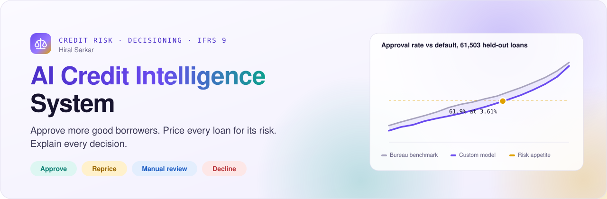
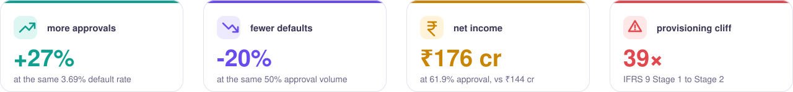
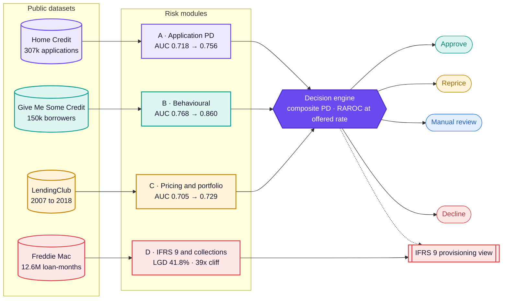

<div align="center">

<a href="https://ai-credit-intelligence-system.vercel.app"></a>

<br>

<a href="https://ai-credit-intelligence-system.vercel.app"></a>
&nbsp;
<a href="https://github.com/hiralsarkar/AI-Credit-Intelligence-System/actions/workflows/ci.yml"></a>


<h3>Approve more good borrowers. Price every loan for its risk. Explain every decision.</h3>

<a href="#-the-problem">Problem</a> ·
<a href="#-how-it-works">How it works</a> ·
<a href="#-results">Results</a> ·
<a href="#-the-self-audit">Self-audit</a> ·
<a href="#-credit-decision-studio">Studio</a> ·
<a href="#-run-it">Run it</a> ·
<a href="#-scope-and-honest-limitations">Limitations</a>

</div>

<br>



<br>

## 🎯 The problem

Most lenders start with a **bureau-score cutoff**: approve everyone above a number. It is simple, and it is expensive. I built this system to measure how expensive, and to fix it. Every module answers one question a credit committee actually asks, and is measured against the simple benchmark a lender would use without it.

<table>
<tr>
<td width="25%" valign="top">

### 🙅 Good borrowers declined
A generic score ranks risk coarsely, so the cutoff turns away people who would have repaid.

**13.6 pts** of approval left on the table

</td>
<td width="25%" valign="top">

### 🏷️ Loans priced blind
A risky loan at a safe loan's rate earns less than the capital it ties up.

Bands 4 and 5 run at **negative RAROC**

</td>
<td width="25%" valign="top">

### 🏦 Provisions surprise
Under IFRS 9, a loan that deteriorates must hold lifetime expected loss, not 12 months of it.

**0.06% → 2.45%** ECL at Stage 2

</td>
<td width="25%" valign="top">

### 💬 Scores without reasons
A number with no explanation cannot be defended to a customer, an auditor or a regulator.

**Every** decision carries reason codes

</td>
</tr>
</table>

## 🧭 How it works

Four specialist models, each trained on a real public dataset, feed one decision engine that applies credit policy in a fixed, auditable order.



**The decision rules**, applied in order (the first match wins):

| # | Rule | Outcome |
|:-:|---|---|
| 1 | Composite PD of 35% or more | 🔴 Decline |
| 2 | Behavioural red flags (5+ delinquencies, 80%+ utilisation, 60/90 DPD events) | 🔵 Manual review |
| 3 | Concentration flag with market-implied PD above 25% | 🔵 Manual review |
| 4 | PD under 20% but offered rate below breakeven (or below the market grade rate) | 🟡 Reprice, or decline above the 24% ceiling |
| 5 | PD under 10% and RAROC at the offered rate of 14% or more | 🟢 Approve |
| 6 | RAROC below the 14% hurdle | 🔴 Decline |
| 7 | Everything else, including thin-file applicants | 🔵 Manual review |

Composite PD blends Module A (60%) and Module B (40%). Module C steers pricing and concentration, and Module D adds the IFRS 9 provisioning view without ever gating origination. Every threshold lives in [`04_decision_engine/constants.py`](04_decision_engine/constants.py).

## 📈 Results

On **61,503 held-out loans**, the custom model's approved book defaults less than the benchmark's at every approval rate.

| | 🏛️ Bureau-score benchmark | ✨ Custom model | Gain |
|---|:-:|:-:|:-:|
| Discrimination (AUC) | 0.718 | **0.756** | +0.038 |
| Default at the same 50% approval | 3.69% | **2.95%** | **-20%** |
| Approval at the same 3.69% default | 50.0% | **63.6%** | **+27%** |
| Net income (₹ crore) | 144.4 | **176.2** at 61.9% | **+22%** |

**Recommended operating point: 61.9% approval at 3.61% default.** That is higher approval *and* lower default than the benchmark, at the same time. Income peaks at 63.7% within risk appetite; I recommend one prudent step inside it.

| Module | Question it answers | Benchmark | Custom | Business lift |
|---|---|:-:|:-:|---|
| 🟣 **A** Application | Who should we approve? | 0.718 | **0.756** | +27% volume or -20% default |
| 🟢 **B** Behavioural | How is the borrower behaving? | 0.768 | **0.860** | catches 81% of delinquents vs 71% at 30% capacity |
| 🟡 **C** Pricing | Is the rate right for the risk? | 0.705 | **0.729** | +3.7 pts approval, -4.9% default |
| 🔴 **D** IFRS 9 | What is the lifetime loss? | snapshot proxy | **panel staging** | 39x Stage 1 to 2 cliff, measured LGD 41.8% |

Module D's transition matrix (28.5% monthly cure from Stage 2 to Stage 1) and vintage curves (2008 crisis 6.0% vs 2011 1.1% default) carry the provisioning case. Its surgical-strike score, which ranks the live Stage 2 book by roll-to-loss risk times measured persuadability, raises avoided expected loss to 2.7x the risk-only status quo at the same contact capacity. See [Module D](04_module_d_ecl_ifrs9/README.md#surgical-strike-fused-priority-targeting) for the method and its causal caveats.

### How much to trust these numbers

A robustness step ([`_robustness_a.py`](01_module_a_application_risk/_robustness_a.py)) re-tests Module A the way a validator would: it separates the gain from **more data** versus **a better algorithm**, checks that the PD is **calibrated** enough to price with, picks the operating point on a **validation set** and reports it on untouched test loans, and puts **95% bootstrap intervals** on every headline figure. See the [Module A README](01_module_a_application_risk/README.md#robustness-checks).

## 🛠️ The self-audit

I audited my engine line by line and found that **RAROC was always computed at a fixed 12% rate**, whatever the loan was actually priced at. A 6.5% teaser loan looked as profitable as a 12% one, and repricing could never change the numbers. The current engine fixes that and six other issues, with tests that keep them fixed.

| | Before the audit | After the audit |
|---|---|---|
| 💰 **Pricing** | RAROC at a fixed 12%, a function of PD alone | RAROC at the **offered rate**, plus a **breakeven rate** that exactly meets the 14% hurdle |
| 🔁 **Repricing** | Only when Module C said "Underpriced" | When the offered rate is below breakeven or the grade rate; rounded up to 25 bp; decline above the 24% ceiling |
| 🧾 **Thin file** | An invented 6.7% behavioural PD in the narrative | No synthetic values; a data-gap reason; routed to an analyst |
| 📋 **Reasons** | One decline path could produce an empty adverse-action notice | Every route records a reason, proven over 1,000+ input combinations |
| 🧭 **Next steps** | None | Every non-approval states what would change it: the PD or the rate needed |
| ⚙️ **Config** | Thresholds repeated as literals | Every threshold read from `constants.py` |
| 🎯 **Consistency** | SC3 was 62.6% in one output, 61.9% elsewhere; Windows-only paths | One shared SC3 rule; portable paths; both guarded by tests |

> **Karan Desai** is offered a 6.5% teaser rate on ₹4 lakh. Before the audit, the engine scored him at 12% and approved at 74% RAROC. Now it sees 9% RAROC against a 14% hurdle and reprices to **7.00%**, the lowest rate at which the loan earns its capital.

## 🖥️ Credit Decision Studio

<a href="https://ai-credit-intelligence-system.vercel.app"></a>

The front end tells the story, lets an analyst work a queue, and shows the evidence. It runs the same rules as the Python engine and matches it exactly on 1,120 test inputs.

| 🏠 Home | 🧑‍💼 Analyst workbench | 📊 Evidence |
|---|---|---|
| The problem, the architecture, the results, the self-audit, and how I talk about the project in an interview | A live queue, a verdict with reasons, each model's signal, what-if sliders, one-click repricing, and a copyable decision notice | The frontier, AUC lift, collections capture, RAROC by band, vintage curves, ECL by stage and the transition matrix |

Source: [`06_docs/decision_studio.html`](06_docs/decision_studio.html), a single self-contained page. It deploys to Vercel on every push to `main` (config in [`vercel.json`](vercel.json)), and you can also open it straight from a clone.

## 🚀 Run it

The decision engine runs with **no data download**:

```bash
pip install -r requirements.txt
python 04_decision_engine/demo.py                                          # six applicants, one per outcome plus teaser-rate and thin-file
python 04_decision_engine/demo.py --pd_a 0.07 --pd_b 0.05 --offered_rate 6.5   # score your own applicant
python 04_decision_engine/demo.py --pd_a 0.16 --thin_file --offered_rate 13     # no behavioural history
python 01_module_a_application_risk/_robustness_a.py                       # ablation, calibration, 95% intervals (needs Home Credit data)
pytest                                                                     # 28 tests
```

To regenerate every figure from raw data, place the datasets (see [Data](#-data)) and run:

```bash
python run_all.py              # runs the module pipelines in order, on a fixed seed
python run_all.py --check      # lists which raw datasets are present or missing
python tools/run_notebooks.py  # re-executes notebooks whose data is present
```

`run_all.py` skips any module whose raw data is absent and says where to get it. Every figure is regenerated on a fixed seed (42).

## 📁 Repository structure

```
01_module_a_application_risk/        🟣 Origination PD, scorecard, RAROC frontier, swap-set, stress
02_module_b_behavioural_risk/        🟢 Delinquency model, collections capture, SHAP
03_module_c_portfolio_pricing_risk/  🟡 Grade and market-implied PD, pricing, reject inference
04_module_d_ecl_ifrs9/               🔴 IFRS 9 staging, transition matrix, lifetime ECL, collections uplift
04_decision_engine/                  ⚙️  Composite signal, decision rules, explainability, audit trail
05_governance/                       🛡️  Model cards, SR 11-7, RBI MRM, regulatory alignment
06_docs/                             🖥️  Credit Decision Studio and methodology papers (HTML)
tests/                               ✅ Engine contracts, output guards, hygiene checks
```

Each module follows the same layout: `01_data/` (raw data is downloaded separately), `02_notebooks/`, `03_models/`, `04_outputs/`.

## ⚖️ Scope and honest limitations

This is a portfolio study on public data, built to institutional conventions. Read the results with these caveats, which the analysis states rather than hides:

- **The benchmark is a bureau-score cutoff, not a production scorecard.** The lift shown is over a generic bureau score, the baseline before a custom model exists.
- **The integration is illustrative.** The four modules train on four unrelated public datasets. The composite PD and decision engine show *how* the signals combine; they are a reference design, not one book scored end to end.
- **Module A's origination "staging" is a PD-bucket proxy.** A single application snapshot cannot express a significant increase in credit risk. All credible IFRS 9 staging is in Module D, on the Freddie Mac monthly panel.
- **The collections uplift model is observational.** Loan modification was not randomly assigned, so the effect is confounded. The surgical-strike score compares targeting strategies under that same estimate; a randomised holdout is required before any of it informs capital or budget.
- **Capital is set at 10.5% of risk-weighted assets,** which makes single-loan RAROC look high. The ranking of decisions is what matters.
- **The data is public** (Kaggle and Freddie Mac). Figures are reproducible and describe these datasets, not a live portfolio.

## 🛡️ Governance and standards

Built to these conventions (not a formal validation):

| Standard | How it shows up |
|---|---|
| **SR 11-7** | Development, validation and monitoring; benchmark vs challenger; audit trail for every decision |
| **RBI MRM** | Model inventory, risk-tier classification, a model card per module |
| **Basel III / ICAAP** | Expected loss, RWA, economic capital, four-scenario stress testing |
| **IFRS 9** | Stage 1 / 2 / 3 allocation, lifetime PD from the survival curve, ECL by stage |
| **Fair Practices Code** | Adverse-action notices with plain-language reason codes |

## 📚 Data

Home Credit Default Risk · Give Me Some Credit · LendingClub 2007-2018 · Freddie Mac Single-Family Loan Performance (2008-2011). Raw files are downloaded separately and are not committed.

<br>

<div align="center">

**Hiral Sarkar** · Credit risk, data science and decisioning

<a href="https://ai-credit-intelligence-system.vercel.app">Live Studio</a> ·
<a href="https://github.com/hiralsarkar">GitHub</a>

<sub>Every figure traces to an executed pipeline and is built to standard risk conventions.</sub>

</div>
